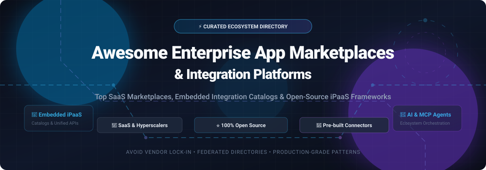

  

# 🌐 Awesome Enterprise App Marketplace & Integrations

### ⚡ Curated Ecosystem Directory: Top SaaS Marketplaces, Embedded Integration Catalogs & Open-Source iPaaS Frameworks

*A production-ready guide to enterprise app stores, third-party connector catalogs, iPaaS tools, and developer-friendly marketplace platforms.*

**Last updated: March 2026**

---

## 📖 Overview

Enterprise application marketplaces and integration platforms have evolved into the core nervous system of modern business software. From hyperscalers and CRM giants offering tens of thousands of plug-and-play apps and AI agents, to open-source embedded iPaaS platforms providing white-label catalogs with full code ownership, this repository curates the best tools for software builders, platform engineers, and enterprise architects.

Whether you are evaluating **commercial ecosystem platforms** (Salesforce AgentExchange, Microsoft AppSource, Atlassian Marketplace) or seeking **open-source frameworks** (n8n, Medusa, Activepieces, Airbyte, Nango, Panora) to embed integrations without vendor lock-in or per-tenant licensing fees, this directory covers the landscape with transparent pricing, exact free tier limits, and verifiable GitHub star ratings.

---

## 📑 Table of Contents

- [📊 Sector Overview & Market Dynamics](#-sector-overview--market-dynamics)
- [🏢 SaaS / Hosted Enterprise Marketplaces](#-saas--hosted-enterprise-marketplaces)
- [⭐ Open-Source GitHub Projects & Catalogs](#-open-source-github-projects--catalogs)
  - [🏆 Ranked by GitHub Community Stars](#-ranked-by-github-community-stars)
  - [💡 Framework Recommendation Matrix](#-framework-recommendation-matrix)
- [🤝 How to Contribute](#-how-to-contribute)
- [💖 Support](#-support)
- [📈 Star History](#-star-history)
- [⚖️ Disclaimer & Security Best Practices](#️-disclaimer--security-best-practices)

---

## 📊 Sector Overview & Market Dynamics

The enterprise app marketplace and integration platform ecosystem (spanning enterprise iPaaS, B2B embedded catalogs, and app storefronts) represents an estimated market size of **$14B to $18B+**, projected to cross **$40B–$50B+** by the early 2030s at an aggressive **30%+ CAGR**. This growth is heavily accelerated by generative AI agents, Model Context Protocol (MCP) servers, and API-first SaaS ecosystems.

The market structure demonstrates a **two-tier dynamic**:
1. **Moderately Concentrated Platform Anchors**: Dominant cloud hyperscalers and CRM monoliths (Microsoft, Salesforce) exert enormous data gravity. Their proprietary marketplaces capture the largest enterprise software budgets and lock in recurring subscriptions.
2. **Highly Fragmented & Competitive Integration Layer**: The embedded connector and iPaaS landscape remains intensely fragmented. Innovative open-source projects (n8n, Medusa, Activepieces, Airbyte, Nango, Panora) are rapidly gaining traction, offering developer teams full data sovereignty, zero transaction fees, and escape velocity from proprietary lock-in.

---

## 🏢 SaaS / Hosted Enterprise Marketplaces

The table below lists the market-leading hosted enterprise application marketplaces, ranked by company scale (market capitalization / enterprise valuation).

| Product | Company Size (Valuation / Revenue) | Description | Starting Pricing | Free Tier / Trial Limits |
|:---|:---|:---|:---|:---|
| **[Microsoft AppSource](https://appsource.microsoft.com/)** | **~$3.89T Market Cap** (~$270B+ annual revenue) | Microsoft's enterprise marketplace for business apps, add-ins, and AI agents across Dynamics 365, Power Platform, Microsoft 365, and Azure. | Free to browse; underlying platform apps (e.g. Microsoft 365 Business Basic) start at **$7.00/user/month** (annual commitment) | **30-day free trial** with up to 25 users (requires payment method for verification; includes 1 TB OneDrive storage and 100 GB mailbox) |
| **[Salesforce AgentExchange](https://www.salesforce.com/)** | **~$179B Market Cap** (~$43.9B annual revenue) | **The largest enterprise app marketplace, now unified with AI agents.** Relaunched April 2026 merging AppExchange, Slack Marketplace, and Agentforce into one catalog: **10,000+ Salesforce apps, 1,000+ Agentforce agents, and 2,600+ Slack apps**. | Free to browse; underlying Salesforce Starter Suite starts at **$25.00/user/month** (billed annually or monthly) | **30-day free trial** for up to 10 users (capped at 2,000 combined leads/contacts and 10 emails/day; permanent Free Suite tier capped at 2 users) |
| **[Atlassian Marketplace](https://marketplace.atlassian.com/)** | **~$38B Market Cap** (~$6.9B annual revenue) | Marketplace for Jira, Confluence, and Atlassian products with thousands of apps. Extends issue tracking, ITSM, and agile collaboration with third-party extensions. | Free to browse; underlying Jira Cloud Standard tier starts at **$7.91/user/month** (monthly) or **$6.52/user/month** (annual) | **Free forever plan** for up to 10 users with 2 GB total storage and 150 automation executions/month; most paid marketplace apps include **30-day free trials** |
| **[Zoho Marketplace](https://marketplace.zoho.com/)** | **~$12.5B Valuation** (~$1.5B annual revenue, bootstrapped) | **2,500+ extensions** for Zoho products. Extends Zoho CRM, Desk, and other apps with integrations for Looker Studio, Dropbox, Intercom, and more. | Free to browse; underlying Zoho CRM Standard tier starts at **$14.00/user/month** (annual) or **$20.00/user/month** (monthly) | **Free forever plan** for up to 3 users with 5,000 records, 1 GB storage, and 5,000 API credits/day; paid tiers offer a **15-day free trial** |
| **[HubSpot App Marketplace](https://www.hubspot.com/)** | **~$10.6B Market Cap** (~$3.58B annual revenue) | Marketplace for HubSpot CRM integrations. Extends marketing, sales, customer service, and CMS hubs with third-party tools. | Free to browse; underlying HubSpot Starter tier starts at **$20.00/seat/month** | **Free forever plan** for up to 2 users with 1,000 contacts, 2,000 email sends/month, and basic pipelines; premium tiers offer a **14-day free trial** |
| **[Slack App Directory](https://slack.com/apps)** | Part of Salesforce (acquired for **$27.7B Valuation**) | Directory of Slack apps for workflow automation, alerts, and bot collaboration. **2,600+ apps** discoverable via AgentExchange for Salesforce users. | Free to browse; Slack Pro tier starts at **$7.25/active user/month** (annual) or **$8.75/active user/month** (monthly) | **Free forever plan** with 90-day message/file history retention, 10 app integrations limit, 5 GB total storage, and 1:1 huddles |
| **[Workato AI Marketplace](https://www.workato.com/)** | **~$5.7B Valuation** (~$150M–$190M ARR) | Curated catalog of enterprise AI solutions—**Genies** (purpose-built AI agents), MCP Servers, and partner accelerators. | Included with Workato platform; self-serve Workato Pro starts at **$75.00/month** (credit-based self-serve slider) | **Free plan** with a one-time grant of 50,000 credits for platform testing; Otto AI add-on includes a **30-day free trial** with 500 credits |
| **[Freshworks Marketplace](https://www.freshworks.com/)** | **~$3.15B Market Cap** (~$930M annual revenue) | App marketplace for Freshworks products (Freshdesk, Freshservice, Freshsales). Extends CRM, support, and IT service workflows with third-party integrations. | Free to browse; underlying Freshdesk Growth tier starts at **$19.00/agent/month** (annual) or **$23.00/agent/month** (monthly) | **14-day free trial** of Enterprise edition (no credit card required); limited Startup Free program offers 6 months free for up to 2 agents |

---

## ⭐ Open-Source GitHub Projects & Catalogs

Open-source marketplace frameworks and integration catalogs empower developers to embed integrations directly into products, customize connectors, and avoid per-tenant licensing fees.

### 🏆 Ranked by GitHub Community Stars

All repositories below are strictly sorted in descending order by GitHub community Stars_Count. Each Stars_Badge links directly to the stargazers page of that repository.

| Project | GitHub_Stars | License | Primary Stack | Core Description & Best Use Case |
|:---|:---:|:---:|:---:|:---|
| **[n8n](https://github.com/n8n-io/n8n)** |  | Sustainable Use License | TypeScript / Node.js | **Leading self-hosted workflow automation & iPaaS engine.** Boasts 400+ pre-built integration nodes, community node sharing, visual flow builder, and native AI/LangChain/MCP support. **Best for:** Teams seeking a self-hosted, enterprise-grade integration engine with an enormous connector ecosystem. |
| **[Appwrite](https://github.com/appwrite/appwrite)** |  | BSD-3-Clause | C++ / PHP / Docker | **Self-hosted Backend-as-a-Service with a comprehensive Functions & Integrations Marketplace.** Offers pre-built function templates, third-party authentication connectors, webhooks, and storage adapters. **Best for:** Builders looking to roll out modular backend services with drop-in integrations. |
| **[Medusa](https://github.com/medusajs/medusa)** |  | MIT | TypeScript / Node.js | **Open-source composable commerce & marketplace engine.** Powers modular multi-vendor marketplaces, app plugins, payment gateways, and shipping provider integrations with an extensible plugin architecture. **Best for:** Teams constructing modern digital marketplaces with total code control. |
| **[Activepieces](https://github.com/activepieces/activepieces)** |  | MIT | TypeScript / Node.js | **Open-source automation platform with an expanding "pieces" connector catalog.** Features a lightweight visual flow builder, self-hostable Docker architecture, and AI/MCP workflow support. **Best for:** Teams wanting an open-source Zapier alternative with an easily extensible piece catalog. |
| **[Airbyte](https://github.com/airbytehq/airbyte)** |  | Elv2 / MIT | Java / Python / React | **The leading open-source data integration engine & connector catalog.** Features 350+ pre-built connectors for databases, SaaS APIs, and data warehouses, with a visual Connector Builder to scaffold custom API integrations in minutes. **Best for:** Managing complex data pipeline integrations and ELT workflows. |
| **[Automatisch](https://github.com/automatisch/automatisch)** |  | AGPL-3.0 | JavaScript / React | **Business automation tool designed for privacy & GDPR compliance.** Provides an intuitive interface to connect software without sending sensitive customer data to third-party cloud providers. **Best for:** Privacy-conscious organizations needing standard SaaS workflow integrations. |
| **[Nango](https://github.com/NangoHQ/nango)** |  | Elastic License 2.0 | TypeScript / Node.js | **Developer-first unified API and integration platform.** Provides 800+ pre-built API scripts with full code ownership, managed OAuth, continuous sync, and webhook handling. **Best for:** B2B SaaS engineering teams building native product integrations directly in code. |
| **[Mercur](https://github.com/mercurjs/mercur)** |  | MIT | TypeScript / Medusa | **Open-core marketplace platform built on Medusa.** Uses a block-based architecture allowing teams to install modules, workflows, and vendor onboarding directly into their project with zero transaction fees. **Best for:** Engineering teams building custom multi-vendor catalogs and software marketplaces. |
| **[Panora](https://github.com/panoratech/Panora)** |  | AGPL-3.0 | TypeScript / Docker | **Open-source integration catalog & unified API for SaaS products (alternative to Merge.dev).** Pre-built multi-tenant catalog with customer integration management, white-label customization, and tenant isolation. **Best for:** SaaS vendors seeking to embed an integration marketplace without per-tenant fees. |
| **[Cenit IO](https://github.com/cenit-io/cenit)** |  | MIT | Ruby / React | **100% open-source iPaaS platform.** Full integration framework with support for complex data transformations (EDI, JSON, XML), routing, and Odoo ERP client add-ons. **Best for:** Organizations wanting a self-hosted open-source iPaaS foundation. |
| **[World Vibe Web (WVW)](https://github.com/f/wvw.dev)** |  | MIT | TypeScript / Actions | **Federated app store demonstrating a no-gatekeeper marketplace model.** Each developer hosts an `apps.json` file in their repository; GitHub Actions aggregates them into a decentralized catalog every 6 hours without central gatekeeping or revenue cuts. **Best for:** Reference architecture for federated, decentralized software directories. |
| **[Prismatic Components](https://github.com/prismatic-io/components)** |  | Apache-2.0 | TypeScript | **Production-grade connector library synchronized directly with Prismatic's production engine.** B2B developers can fork battle-tested connectors (Salesforce, NetSuite, HubSpot) to accelerate in-house integration builds. **Best for:** Reference implementations for enterprise connectors. |

---

### 💡 Framework Recommendation Matrix

- **Embedded In-App Integration Catalogs:** Use **Panora** or **Nango** for unified API abstraction, managed OAuth token refreshes, and multi-tenant self-service setups inside your SaaS.
- **Workflow Automation & iPaaS Engines:** Use **n8n** or **Activepieces** for visual orchestration, expansive connector libraries, and AI/MCP tool execution.
- **Custom Multi-Vendor Marketplaces:** Use **Medusa** or **Mercur** for modular, block-based commerce engines with zero transaction fees.
- **Data Pipeline & Warehouse Integrations:** Use **Airbyte** for high-volume ELT replication across hundreds of pre-built connectors.
- **Hardened Enterprise Connectors:** Leverage **Prismatic Components** as an Apache-2.0 reference architecture for enterprise SaaS connectors.

---

## 🤝 How to Contribute

We welcome community contributions! To add a new platform, connector library, or open-source marketplace project:

1. 🍴 **Fork** this repository.
2. 📝 **Add/Update** your entry in `README.md` following the established table structure.
3. ⭐ Ensure open-source projects include an active GitHub Stars_Badge linking to their stargazers page.
4. 🔍 Keep descriptions concise, factual, and include starting pricing and transparent free tier limits.
5. 🚀 Submit a **Pull Request** with a brief summary of the proposed changes.

---

## 💖 Support

If you find this curated directory helpful, please consider showing your support:

- ⭐ **Star** this repository on GitHub!
- 🍴 **Fork** it and build your own custom integration stack.
- 📢 **Share** it with fellow software engineers, SaaS architects, and founders.
- ☕ **Sponsor the Project:** Buy us a coffee and support ongoing maintenance via the [GitHub Sponsors Dashboard](https://github.com/sponsors/ishandutta2007).

---

## 📈 Star History

---

## ⚖️ Disclaimer & Security Best Practices

- This is an **independent, community-curated** list intended for educational and architectural evaluation. Inclusion does not constitute an endorsement.
- **Security Notice:** Enterprise app marketplaces and integration catalogs interact directly with sensitive customer credentials, OAuth tokens, and cross-application data flows. Always enforce least-privilege permission scopes, automated secret rotation, comprehensive audit logging, and encryption in transit and at rest.
- **Lock-in Awareness:** Proprietary app marketplaces provide convenient out-of-the-box ecosystems but naturally increase platform switching friction and vendor lock-in. Open-source alternatives provide maximum architectural independence and data portability.

---

**Built for platform engineers, SaaS architects, and ecosystem builders.**  
*Let's make enterprise app marketplaces and integrations open, portable, and developer-friendly.*

